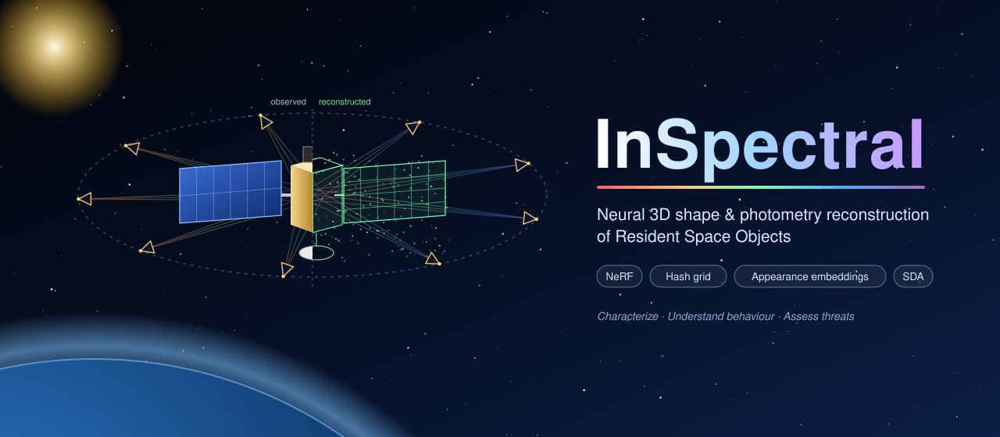
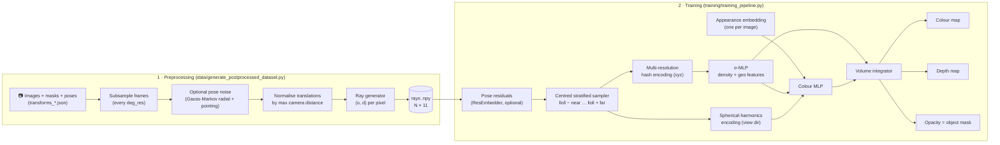

<p align="center">
  
</p>

<p align="center">
  
  
  
  
</p>

<h1 align="center">InSpectral</h1>
<p align="center"><b>See an unknown object in orbit from a handful of pictures, then rebuild its shape and appearance.</b></p>

<p align="center">
  <a href="#-why-inspectral">Why</a> ·
  <a href="#-how-it-works">How it works</a> ·
  <a href="#-repository-layout">Layout</a> ·
  <a href="#-quick-start">Quick start</a> ·
  <a href="#-configuration-reference">Configuration</a> ·
  <a href="#-evaluation-and-analysis">Evaluation</a> ·
  <a href="#-roadmap">Roadmap</a>
</p>

---

## 🛰️ Why InSpectral?

Earth orbit is getting crowded. Besides active satellites there are thousands of **Resident Space Objects (RSOs)**: dead spacecraft, rocket bodies, debris, and sometimes objects whose purpose nobody has declared. Before you can dock with one, service it, remove it, or judge whether it is a **threat**, you need to know *what it is*:

- **What shape is it?** Bus, solar arrays, antennas, appendages, damage.
- **How does it reflect light?** Materials, MLI, solar panels, specular surfaces.

**InSpectral** is the code base of my PhD research on exactly this problem. An inspector spacecraft flies around the target and takes images. A **neural radiance field (NeRF)** turns those images into a **3D model of the RSO's geometry and photometry**. From that model you can

- 🎥 **render novel views** of the object from viewpoints that were never imaged,
- 📏 **estimate dense depth**, i.e. the 3D shape of the object,
- ✂️ **segment the object** from the space/Earth background directly from the learned volume density,
- 🌗 **separate geometry from illumination**: the Sun moves, shadows sweep across the object, and per-image *appearance embeddings* absorb those lighting changes so the geometry stays consistent,
- 🧭 **refine imperfect camera poses**: per-image pose corrections are learned jointly with the radiance field (BARF-style), because an inspector never knows its relative pose exactly.

In orbit the lighting is harsh and changes all the time: hard shadows, eclipses, glints. A vanilla NeRF would "bake" those effects into the geometry. InSpectral is built to keep them apart.

> The model is **channel-agnostic**. Set `IMAGE_MODE` at the top of `configs/config_parameters.py` to `"rgb"` (3 channels), `"ir"` (1 channel, read from each frame's `ir_path`) or `"rgb_ir"` (both stacked, 4 channels) and the whole pipeline (dataset, network output, metrics, renders) follows. That is where the name *In‑Spectral* comes from.

---

## 🧠 How it works

The pipeline has two stages. An **offline preprocessing** step turns a rendered orbit (images + poses + masks) into one big shuffled table of rays. The **training** step then fits a hash-grid NeRF to those rays, validating on full images after every epoch.



### Model components

| Stage | What it does | File |
|---|---|---|
| **Ray generator** | Pinhole camera with intrinsics from the horizontal FOV (`camera_angle_x`). Produces one unit-length ray per pixel in the NeRF/OpenGL convention (x right, y up, camera looking down −z), rotated by the camera-to-world pose. | `data/rays_generator.py` |
| **Sampler** | Stratified, jittered samples along each ray. Sampling is **world-centred**: each ray is sampled between `‖o‖ − near` and `‖o‖ + far`, i.e. a shell of fixed thickness around the origin where the RSO sits. Optional **hierarchical (importance) sampling** adds `n_importance_samples` points drawn from the coarse weights. | `model/sampler.py` |
| **Hash embedder** | Instant-NGP-style multi-resolution hash grid: 16 levels, 2 features per level, 2¹⁹ entries per level, resolutions from 16 to 512 inside the bounding box `[-SCENE, SCENE]³`. Samples outside the box are zeroed. Optional **coarse-to-fine** schedule that fades in the finer levels during training. | `model/hash_embedder.py` |
| **SH encoder** | Encodes the viewing direction in real spherical harmonics (degree 1–5, default 4 → 16 coefficients) for view-dependent effects such as specular glints. | `model/sh_encoder.py` |
| **Appearance embedder** | One learnable vector per training image (default 90 × 16). It captures the illumination and shadow state of that shot so the geometry does not have to. | `model/appearance_embedder.py` |
| **NeRFSmall** | Two small bias-free MLPs. The density branch maps the hash features to raw σ plus `geo_feat_dim` (16) geometric features; the colour branch maps geo features + SH + appearance to colour (sigmoid). | `model/small_nerf.py` |
| **Integrator** | Alpha compositing in FP32. Returns the colour map, a **normalised inverse depth** (near → 1, far → 0, background forced to 0, matching the ground-truth depth PNGs), the **accumulated opacity** used as the object mask, an **entropy sparsity** term, and a mip-NeRF-360-style **distortion** term. | `model/integrator.py` |
| **NeuralRenderer** | Wraps sampler, encoders, NeRF and integrator into one `nn.Module`. | `model/rendering.py` |
| **Occupancy grid** *(opt-in)* | A coarse voxel grid of where the density is non-negligible, refreshed during training. Samples in empty voxels skip the MLPs entirely (zero colour and density), which saves compute on the mostly empty space around an RSO. | `model/occupancy_grid.py` |
| **Pose residuals** | `ResEmbedder` stores a 6-D correction per image (3 translation + 3 rotation as an axis-angle vector), initialised to zero, clamped to ±5 and scaled by `lin_range` (translation) and `ang_range` (rotation). It is turned into Δt and ΔR (Rodrigues) and applied to the ray origins and directions before rendering. | `model/residuals_embedder.py` |

### Training objective

`training/trainer.py` optimises everything with **AdamW** using four parameter groups with separate learning rates (NeRF MLPs `lr`, hash grid `emb_lr`, appearance table `app_lr`, pose table `res_lr`) and a **StepLR** scheduler. Mixed precision (FP16 autocast + GradScaler) is available on CUDA.

| Term | Definition | Weight key | Active |
|---|---|---|---|
| Photometric | MSE between rendered and ground-truth colour | `photometric_loss_weight` | always |
| Sparsity | Shannon entropy of the per-ray sample weights | `sparsity_loss_weight` | always |
| Appearance smoothness | Squared second difference between consecutive appearance embeddings (frames are consecutive along the orbit) | `similarity_loss_weight` | always |
| Distortion | mip-NeRF 360 distortion loss on the sample weights | `distortion_loss_weight` | always (if > 0) |
| Total variation | L1 TV on a random cube of every hash-grid level | `tv_loss_weight` | until `stop_tv_epoch` |
| Segmentation | 0.5 · BCE + 0.5 · Dice between the accumulated opacity and the (pseudo-)mask | `bce_dice_loss_weight` | from `start_seg_epoch` |
| Pose regularisation | Mean squared pose-residual embedding | `camera_pose_reg_weight` | only on pose-update steps |
| Trajectory smoothness *(opt-in)* | High-frequency energy of the corrected trajectory: each pose minus a local quadratic (Savitzky-Golay) fit through its `camera_smoothness_window` neighbours | `camera_smoothness_weight` | only on pose-update steps |

Terms outside their active window are still computed without gradient so they keep appearing in TensorBoard.

**Camera refinement.** Refinement is switched on by `CORRUPTED_POSES = True` (which sets `enable_camera_refinement`). Pose residuals are applied on every `camera_update_interval`-th batch once `camera_warmup_epochs` have passed. With `camera_only = True` those batches update **only** the pose table (the NeRF is frozen for that step), which alternates geometry and pose updates.

**White pose noise.** The residuals alone recover slowly drifting pose errors, but random frame-to-frame noise is hard for the photometric loss to separate from geometry. The trajectory-smoothness prior uses the fact that an inspection orbit is smooth: it penalises only the part of the corrected trajectory that a local quadratic cannot follow, so the orbit's own curvature is left alone. On a synthetic 90-frame orbit with white noise (3 % radial, 0.2° pointing) the prior on its own halves both the position and the attitude error. It needs densely sampled frames (a few degrees apart); on coarse orbits (≥ 15° between frames) leave it off.

**Pose accuracy.** The dataset builder saves the camera poses next to the ray table (`<dataset>_poses.npz`, see below). When the true poses are known, every epoch logs the mean translation and rotation error of the corrected poses, and of the uncorrected input poses for reference, after a similarity (Umeyama) alignment as in BARF. They appear in TensorBoard under `Pose/` and in `chkpt_*.pt`.

### Data conventions

- **Scene normalisation.** Camera translations are divided by the largest camera distance from the origin, so every camera lies within the unit sphere. The distance is taken from the training poses *after* any added noise, and written into the `.npy` filename (`…_min22.88_max40.72_…`). Training validation, `evaluation/performances.py` and `inference/inference.py` all read it back from there, so the test cameras are placed in exactly the scene the model was trained in. `near`, `far` and `SCENE` are expressed in these normalised units.
- **Depth ground truth.** 8-bit PNGs where 255 is the camera origin and 0 is the far limit, linear in between (40 m in the Landsat dataset, so one grey level ≈ 0.16 m). The labels are **Z depth** (distance along the camera's optical axis, not along each pixel's ray). The renderer outputs the same convention: the expected distance along each ray is projected onto the camera's viewing axis (`z = t · cos θ`, set by `dataset_parameters["depth_type"] = "z"`; use `"ray"` for ray-distance labels such as a Mist pass) and mapped linearly so that 0 m is white and `dataset_parameters["depth_max_meters"]` is black, converted to scene units with the dataset scale (`depth_max_meters / max camera distance`). Background (zero opacity) is black, and partly transparent pixels are darkened by their opacity.
- **Depth MAE in metres.** Because both maps are linear in distance with the same black point, a depth MAE of `x` equals `x · depth_max_meters` metres. Training validation logs `Val/Object_Depth_MAE_m`, and `evaluation.performances` prints the object MAE in metres next to the normalised value.
- **Older runs.** Before the black point was tied to `depth_max_meters`, it was fixed at 1.125 scene units (1.125 × the max camera distance, about 45.8 m on Landsat instead of 40 m), which made every predicted depth too bright and added a systematic error of 0.07 to 0.12 to the object MAE. Depth is not part of any loss, so old checkpoints are still valid: re-run `evaluation.performances` on them to get corrected depth metrics. Depth MAE values in older TensorBoard logs are not comparable with new ones.
- **Colour order.** Images are read with OpenCV, so the model learns **BGR**. Saved renders are BGR PNGs (correct when re-read by OpenCV). TensorBoard images and the 3-D plot are converted to RGB.

---

## 📁 Repository layout

```
InSpectral/
├── configs/
│   └── config_parameters.py            ⚙️  all model / training hyperparameters
├── data/
│   ├── generate_postprocessed_dataset.py  images + poses → shuffled ray table (.npy)
│   ├── rays_generator.py               pinhole ray generator (RaysGeneratorSynth)
│   ├── image_io.py                     image modes (rgb / ir / rgb_ir): loading and splitting
│   └── dataset.py                      torch Dataset over the .npy (NeRFData)
├── model/
│   ├── rendering.py                    NeuralRenderer: the full forward pass
│   ├── sampler.py                      stratified + importance sampling
│   ├── hash_embedder.py                multi-resolution hash grid
│   ├── sh_encoder.py                   spherical-harmonics direction encoding
│   ├── appearance_embedder.py          per-image appearance codes
│   ├── residuals_embedder.py           per-image pose corrections
│   ├── small_nerf.py                   density + colour MLPs
│   ├── integrator.py                   volume rendering, depth, opacity, regularisers
│   ├── losses.py                       TV, BCE-Dice and other losses
│   ├── metrics.py                      PSNR / MAE / SSIM (full, object, background)
│   └── occupancy_grid.py               occupancy grid for empty-space skipping
├── training/
│   ├── training_pipeline.py            🚀 entry point: training loop + per-epoch validation
│   ├── trainer.py                      optimiser, scheduler, loss composition
│   └── pose_utils.py                   pose sidecar, smoothness prior, pose-error metrics
├── inference/
│   └── inference.py                    render camera / appearance sweeps from a checkpoint
├── evaluation/
│   ├── performances.py                 evaluate one checkpoint on test views
│   ├── results.py                      plot depth MAE over epochs for two runs
│   ├── compare_results.py              compare many runs from their TensorBoard logs
│   ├── comparison_cases.py             which runs compare_results.py should compare
│   ├── evaluate_ns.py                  score a Nerfstudio baseline with the same metrics
│   └── comparisons/                    saved comparison figures and tables
├── tools/
│   ├── export_geometry.py              export a point cloud / mesh (.ply) from a checkpoint
│   └── generate_video.py               turn a folder of frames into an .avi
├── assets/                             banner and promo video
└── requirements.txt
```

Folders created at run time (all gitignored):

| Folder | Created by | Contents |
|---|---|---|
| `data/postprocessed_dataset/` | `generate_postprocessed_dataset.py` | ray tables `.npy`, pose sidecars `_poses.npz`, trajectory plots |
| `results/folder_<timestamp>/` | `training_pipeline.py` | TensorBoard events and one `epoch_<k>/` per epoch |
| `renders/<timestamp>/` | `inference.py` | rendered views, depth maps, 3-D sample plots |
| `exports/<timestamp>/` | `export_geometry.py` | `point_cloud.ply`, `mesh.ply` |
| `benchmarks/` | Nerfstudio | baseline runs scored by `evaluate_ns.py` |

> **Always run from the repository root, as a module** (`python -m training.training_pipeline`, not `python training/training_pipeline.py`). Imports are absolute from the root (`from model.rendering import …`, `from configs.config_parameters import …`) and relative paths in the configs are resolved from there.

---

## 🚀 Quick start

### 1. Environment

You need **Python 3.12** and an **NVIDIA GPU with CUDA 12.x**.

```bash
git clone https://github.com/Alessandro-Scarciglia/InSpectral.git
cd InSpectral

python3.12 -m venv .venv
source .venv/bin/activate          # Windows: .venv\Scripts\activate

pip install -r requirements.txt
```

`requirements.txt` lists the core dependencies plus the ones used by the evaluation and export scripts (`pandas`, `tensorboard`, `torchmetrics`, `scikit-image`). `nerfstudio` is only needed for `evaluation/evaluate_ns.py` and is commented out.

### How to run the scripts

Every script imports the project's own packages (`configs`, `data`, `model`, `training`, `evaluation`, `inference`, `tools`) by their full name, so run it **from the repository root**. Both forms work:

```bash
python -m training.training_pipeline          # recommended
python training/training_pipeline.py          # also works
```

The same goes for the other entry points, e.g. `python -m data.generate_postprocessed_dataset` or `python data/generate_postprocessed_dataset.py`. Running from the root also keeps relative paths in the configs (such as `data/postprocessed_dataset/` and `results/`) pointing at the right place. Avoid `cd`-ing into a package folder and running `python training_pipeline.py` from there.

### 2. Prepare the source dataset

InSpectral expects a NeRF/Blender-style synthetic orbit:

```
<dataset>/
├── transforms_train.json     nominal (ground-truth) poses, used for training
├── transforms_test.json      optional; validation falls back to transforms_train.json
├── transforms_est.json       optional; estimated poses (trajectory_type = "estimated")
└── images/…                  RGB / IR / depth / mask PNGs referenced by the JSON
```

```jsonc
{
  "camera_angle_x": 0.69,            // horizontal FOV [rad]
  "num_ch": 3,
  "frames": [
    {
      "file_path":  "images/rgb/000.png",    // RGB image (IMAGE_MODE "rgb" / "rgb_ir")
      "ir_path":    "images/ir/000.png",     // IR image (IMAGE_MODE "ir" / "rgb_ir")
      "depth_path": "images/depth/000.png",  // 8-bit depth, 255 = camera, 0 = far
      "mask_path":  "images/mask/000.png",   // binary RSO mask
      "transform_matrix": [[...], [...], [...], [...]]  // 4×4 camera-to-world
    }
  ]
}
```

Frames are assumed to be **consecutive along the orbit** (the appearance-smoothness loss and the validation indexing rely on it).

### 3. Build the ray dataset

First choose the experiment's modality with the two flags at the top of `configs/config_parameters.py` (see [Modality flags](#modality-flags)):

```python
IMAGE_MODE = "rgb"        # "rgb", "ir" or "rgb_ir"
CORRUPTED_POSES = True    # True: noisy poses + pose refinement · False: trusted poses
```

The dataset builder reads both, so the ray table always matches the training run. Then edit the rest of `CONFIG` at the top of `data/generate_postprocessed_dataset.py`:

| Key | Meaning |
|---|---|
| `data_path` | Source dataset folder |
| `data_dst_dir` | Output folder for the `.npy` (normally `data/postprocessed_dataset/`) |
| `src_dataset`, `arch` | Tags written into the output filename |
| `target_resolution` | Image side in pixels (must match `cfg_parameters["resolution"]`) |
| `deg_res` | Keep one frame every `deg_res` (e.g. 4 on a 360-frame orbit → 90 frames) |
| `image_type` | Taken from `IMAGE_MODE`: `"rgb"`, `"ir"` or `"rgb_ir"` (RGB and IR stacked as 4 channels) |
| `masked` | Folder (inside `data_path`) with the masks used for training, e.g. SAM2 pseudo-masks. The image background is blacked out with this mask, and the mask itself becomes the segmentation target. |
| `trajectory_type` | `"nominal"` (`transforms_train.json`) or `"estimated"` (`transforms_est.json`) |
| `enable_trajectory_noise` (= `CORRUPTED_POSES`), `radial_noise_sigma`, `radial_noise_rho`, `radial_noise_corr_deg` | Time-correlated (first-order Gauss-Markov) **radial** position error, as a fraction of the distance. Nominal trajectories only. `rho` is the correlation between consecutive *kept* frames; set `radial_noise_corr_deg` instead to give a correlation length in degrees of orbit (`rho = exp(-spacing / corr_deg)`), which stays the same when `deg_res` changes. The script prints both forms. |
| `enable_pointing_noise` (= `CORRUPTED_POSES`), `pointing_noise_sigma_deg`, `pointing_noise_rho`, `pointing_noise_corr_deg` | Time-correlated **pointing** error around the camera's local x and y axes. Nominal trajectories only. Same correlation options as above. |
| `noise_seed` | Seed for the noise and the final shuffle |

Then run:

```bash
python -m data.generate_postprocessed_dataset
```

The output is a float32 array with one row per pixel, already shuffled:

```
[ ray_origin(3) | ray_direction(3) | colour(C) | mask(1) | image_index(1) ]   C = 3 (rgb), 1 (ir) or 4 (rgb_ir: B, G, R, IR)
```

Its filename encodes the settings, for example
`Landsat8_v4_4_nominal_images_mask_sam2_grounded_bi_arch_4_res512_min22.88_max40.72_rgb_radial0.030_rhor0.90_point0.200_rhop0.90.npy`.
Next to it the script saves a trajectory plot (nominal vs perturbed, with camera frames) and `<same name>_poses.npz` with the normalised input poses and, when known, the ground-truth poses. Training uses that file for the pose-smoothness prior and the pose-error metrics; datasets built before it existed still train normally, just without those two features.

### 4. Configure training

Point `dataset_parameters["data_path"]` at the `.npy` from step 3 and `dataset_parameters["test_path"]` at the source dataset folder, then review the parameters in [Configuration reference](#-configuration-reference). The values that **must** stay consistent with the data:

- `app_parameters["embeddings_num"]` and `res_model_parameters["embeddings_num"]` ≥ number of training frames (90 for 360 frames with `deg_res = 4`).
- `cfg_parameters["resolution"]` equal to `target_resolution` used to build the `.npy`.
- `IMAGE_MODE` and `CORRUPTED_POSES` unchanged since the `.npy` was built (rebuild it after changing either).
- Keep the `min…_max…` part of the `.npy` filename: validation uses it to normalise the test poses.

### 5. Train

```bash
python -m training.training_pipeline
```

1. A run folder `results/folder_<YYYY-MM-DD_HH-MM-SS>/` is created and TensorBoard logging starts there.
2. Every batch of `training_batch` rays is optionally corrected by the pose residuals and passed to the trainer. With `verbose: True`, losses are printed every 10 iterations.
3. **After each epoch** the model renders every 10th frame of the test trajectory and computes PSNR, SSIM (colour) and MAE (depth), each on the full image, on the RSO and on the background (using the ground-truth mask). It saves:
   ```
   epoch_<k>/
   ├── rgb/<frame>.png      rendered colour (also IR-only runs)
   ├── ir/<frame>.png       rendered IR (rgb_ir mode only)
   ├── depth/<frame>.png    rendered depth
   ├── chkpt_nerf.pt        NeRF state + metrics
   └── chkpt_res.pt         pose-residual state + metrics
   ```

Follow the run with:

```bash
tensorboard --logdir results
```

Logged tags: `Train/{Total,Photometric,TV,Sparsity,Driving,Appearance,Distortion}_Loss` (plus `Train/Pose_Smoothness_Loss` when the prior is on), `Val/{Full,Object,Background}_{PSNR,MAE,SSIM}`, `Pose/{,Input_}{Translation_Error,Rotation_Error_deg}` when ground-truth poses are known, and validation images.

**Resuming:** set `training_parameters["pretrained"] = True` and point `checkpoint_nerf` / `checkpoint_res` to the two checkpoint files.

### 6. Render novel views

Edit `INFERENCE_CONFIG` at the top of `inference/inference.py`, then:

```bash
python -m inference.inference
```

| Key | Meaning |
|---|---|
| `checkpoint_path` | `chkpt_nerf.pt` to load |
| `mode` | `"camera"`: move the camera with a fixed appearance · `"appearance"`: keep one camera and sweep the appearance embeddings (shows how lighting/shadows were absorbed) |
| `camera_source` | `"trajectory"` (all poses of the dataset) or `"sphere"` (`views` poses on a Fibonacci sphere of radius `sphere_radius`) |
| `appearance_position` | Embedding index to use in camera mode; fractional values interpolate between neighbours |
| `camera_index`, `appearance_start`, `appearance_end`, `appearance_steps` | Appearance sweep settings |
| `normalization_stride` | Must equal `deg_res` used for the training dataset |
| `visualize_3d`, `visualize_3d_index`, `pixel_stride`, `sigma_threshold`, `show_3d` | Save (and show) a 3-D scatter of the samples with σ above the threshold for one view, plus the raw samples as `.npz` |

Outputs go to `renders/<timestamp>/`: `view_XXXX.png`, `view_XXXX_depth.png` (plus `view_XXXX_ir.png` in rgb_ir mode; `appearance_…` names in appearance mode), and optionally `…_3d.png` / `…_samples.npz`.

### 7. Export the geometry

Edit `EXPORT_CONFIG` at the top of `tools/export_geometry.py`, then:

```bash
python -m tools.export_geometry
```

The density is sampled on a `grid_resolution`³ grid inside the bounding box. Samples above `density_threshold` are written as a coloured **point cloud**, and the iso-surface at the same level as a **mesh** (marching cubes, scikit-image). Colours come from the colour branch with the mean appearance embedding (or `appearance_index`) and a view direction looking at the object centre; in rgb_ir mode the IR value is stored as an extra `ir` vertex property. Set `output_units = "dataset"` to get coordinates in the units of `transforms.json` (e.g. metres) instead of normalised scene units. Files go to `exports/<timestamp>/` and open in MeshLab, CloudCompare or Blender.

---

## ⚙️ Configuration reference

All training hyperparameters live in `configs/config_parameters.py`, grouped in dictionaries. Defaults shown are the current values in the file.

### Modality flags

Two flags at the top of the file select the experiment's modality. Both the dataset builder and training read them, so rebuild the dataset after changing either:

| Flag | Values | Effect |
|---|---|---|
| `IMAGE_MODE` | `"rgb"` (default), `"ir"`, `"rgb_ir"` | Which images are rendered and supervised. Sets `dataset_parameters["mode"]`, the channel count and the builder's `image_type`. |
| `CORRUPTED_POSES` | `True` (default), `False` | `True`: the builder adds the configured pose noise (nominal trajectories) and training learns per-image pose corrections (`enable_camera_refinement`). `False`: poses are trusted, no noise and no refinement. |

| Dictionary | Key parameters |
|---|---|
| `dataset_parameters` | `data_path` (ray `.npy`), `test_path` (source dataset folder for validation), `mode` (set by `IMAGE_MODE`) |
| `cfg_parameters` | `resolution` (512), `channels` (derived from `IMAGE_MODE`), `device` |
| `rays_parameters` | derived from `cfg_parameters`, no need to edit |
| `sampler_parameters` | `n_ray_samples` (64), `near` / `far` (0.4 / 0.4: half-thickness of the sampled shell in front of and behind the origin), `enable_hierarchical_sampling`, `n_importance_samples`, `importance_eps` |
| `hash_parameters` | `bbox` (`±SCENE`, SCENE = 0.25), `n_levels`, `n_features_per_level`, `log2_hashmap_size`, `low_res`, `high_res`, coarse-to-fine: `enable_coarse_to_fine`, `min_visible_levels`, `level_warmup_start_epoch`, `level_warmup_steps` |
| `occupancy_parameters` | `enable_occupancy_grid` (off), `grid_resolution` (128), `occupancy_threshold` (raw density below which a voxel is empty), `occupancy_warmup_steps` (steps before the first update), `occupancy_update_interval`. A checkpoint trained with the grid on must be loaded with it on. |
| `sh_parameters` | `degree` (4) |
| `app_parameters` | `embeddings_num` (≥ training frames), `embeddings_dim` (16) |
| `nerf_parameters` | `n_layers`, `hidden_dim`, `geo_feat_dim`, `n_layers_color`, `hidden_dim_color`; input/output sizes are derived |
| `res_model_parameters` | `embeddings_num`, `lin_range` (translation step per unit of embedding, normalised units), `ang_range` (rotation step per unit of embedding, rad); the embedding is clamped to ±5, so the largest correction is 5 × the range |
| `training_parameters` | batch & schedule: `training_batch` (4096 rays), `epochs`, `lr`, `emb_lr`, `app_lr`, `res_lr`, `betas`, `eps`, `decay_rate`, `decay_steps`, `mixed_precision` · loss weights: see [Training objective](#training-objective) · loss windows: `stop_tv_epoch`, `start_seg_epoch` · camera refinement: `enable_camera_refinement` (set by `CORRUPTED_POSES`), `camera_warmup_epochs`, `camera_update_interval`, `camera_only`, `camera_smoothness_weight` (0 = off), `camera_smoothness_window` · resuming: `pretrained`, `checkpoint_nerf`, `checkpoint_res` |

> A few keys are kept for experiments but are **not read by the current code**: `emb_norm_loss_weight`, `driving_loss_w_bg`, `driving_loss_w_fg`, `driving_loss_dice_weight`, and `driving_loss_softness` / `driving_loss_gamma` (passed to the trainer but only used by the alternative `TunableBimodalDrivingLoss`, which is commented out in favour of BCE-Dice).

---

## 📊 Evaluation and analysis

Every script is configured by a dictionary at the top of the file and run from the repository root.

| Command | Purpose |
|---|---|
| `python -m evaluation.performances` | Loads one `chkpt_nerf.pt`, renders every `test_stride`-th frame and prints PSNR (colour) and MAE (depth) for full / object / background. Set `interactive_display` to step through the frames (`q` to quit). |
| `python -m evaluation.results` | Plots depth MAE (RSO vs background) over epochs for two runs, e.g. with and without segmentation. |
| `python -m evaluation.compare_results [--list] [--case NAME]` | Reads the TensorBoard logs of the runs listed in `evaluation/comparison_cases.py` and writes paper-ready figures (PDF + PNG) and tables (CSV + `comparison_statistics.xlsx`) to the case's output folder: metric vs epoch, object metrics, object-background gaps, relative improvement, training losses, final / best / AUC / convergence statistics. |
| `python -m evaluation.evaluate_ns` | Scores a Nerfstudio baseline (e.g. Instant-NGP) on the same images with the same depth convention, and writes a `metrics.json`. Requires `nerfstudio`. |
| `python -m tools.export_geometry` | Exports a point cloud and a mesh (`.ply`) from a checkpoint, see [step 7](#7-export-the-geometry). |
| `python -m tools.generate_video` | Turns a folder of numbered frames (`000.png`, or `000_d.png` etc. via `series`) into an `.avi`. |

To add a comparison, add an entry to `COMPARISON_CASES`:

```python
"my_case": {
    "description": "What this comparison tests.",
    "experiments": [
        {"name": "Baseline", "folder": "results/folder_2026-11-05_18-24-13"},
        {"name": "With X",   "folder": "results/folder_2026-11-06_10-11-48"},
    ],
    "output": COMPARISON_ROOT / "my_case",
},
```

The `evaluation/comparisons/` folder already holds the studies run so far (appearance embedding capacity and similarity, dataset version robustness, photometric / segmentation / sparsity / TV weight sweeps, ray sampling trade-off, pose uncertainty, sampling, segmentation).

---

## 🗺️ Roadmap

- [x] Hash-grid NeRF with SH view encoding for RSO reconstruction
- [x] Geometry/illumination decoupling with per-image appearance embeddings
- [x] Density-based RSO segmentation (BCE-Dice on accumulated opacity, trained on SAM2 pseudo-masks)
- [x] Object-vs-background evaluation of PSNR, SSIM and depth MAE
- [x] Pose-noise simulation (time-correlated radial and pointing errors) in the dataset builder
- [x] Joint camera-pose refinement with pose-error metrics against ground truth
- [x] Trajectory-smoothness prior for white (frame-to-frame) pose noise (opt-in)
- [ ] Validate the white-noise prior on the full Landsat orbit and tune `camera_smoothness_weight`
- [x] Infrared (`ir`) and stacked RGB + IR (`rgb_ir`) inputs
- [ ] More spectral bands beyond RGB + IR
- [x] Occupancy-grid empty-space skipping (opt-in)
- [x] Point-cloud and mesh export (`tools/export_geometry.py`)

---

## 📄 Publications

- *Learning-based 3D reconstruction from single-orbit data*, SPAICE 2026.
- A journal paper regarding the end-to-end algorithm and dataset design is forthcoming.

---

## 👤 Author

**Alessandro Scarciglia**, PhD research on 3D reconstruction of unknown Resident Space Objects.
GitHub: [@Alessandro-Scarciglia](https://github.com/Alessandro-Scarciglia)

<p align="center"><i>Built to look closely at what is up there. 🌍🛰️</i></p>
