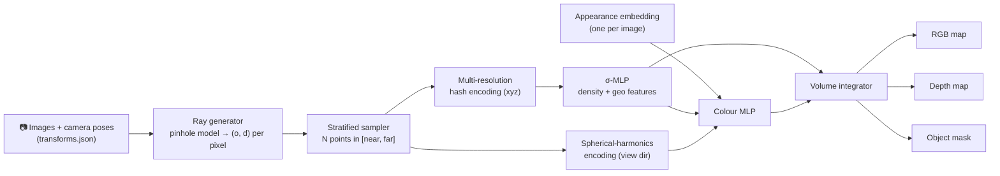

<p align="center">
  
</p>

<p align="center">
  
  
  
  
</p>

<h1 align="center">InSpectral</h1>
<p align="center"><b>See an unknown object in orbit from a handful of pictures, then rebuild its shape and appearance.</b></p>

---

## 🛰️ Why InSpectral?

Earth orbit is getting crowded. Besides active satellites there are thousands of **Resident Space Objects (RSOs)**: dead spacecraft, rocket bodies, debris, and sometimes objects whose purpose nobody has declared. Before you can dock with one, service it, remove it, or judge whether it is a **threat**, you need to know *what it is*:

- **What shape is it?** Bus, solar arrays, antennas, appendages, damage.
- **How does it reflect light?** Materials, MLI, solar panels, specular surfaces.

**InSpectral** is the code base of my PhD research on exactly this problem. An inspector spacecraft flies around the target and takes images. A **neural radiance field (NeRF)** turns those images into a **3D model of the RSO's geometry and photometry**. From that model you can

- 🎥 **render novel views** of the object from viewpoints that were never imaged,
- 📏 **estimate dense depth**, i.e. the 3D shape of the object,
- ✂️ **segment the object** from the space/Earth background directly from the learned volume density,
- 🌗 **separate geometry from illumination**: the Sun moves, shadows sweep across the object, and per-image *appearance embeddings* absorb those lighting changes so the geometry stays consistent.

That last point is the heart of the current architecture (`geometry_shadow_decoupling/`). In orbit the lighting is harsh and changes all the time: hard shadows, eclipses, glints. A vanilla NeRF would "bake" those effects into the geometry. InSpectral is built to keep them apart.

> The model is **channel-agnostic** (`channels` in the config). The current pipeline is trained on RGB imagery, and the same architecture is designed to extend to other spectral bands (e.g. infrared). That is where the name *In‑Spectral* comes from.

---

## 🧠 How it works



| Stage | What it does | File |
|---|---|---|
| **Rays** | Builds one ray (origin + direction) per pixel from the camera-to-world pose and a pinhole intrinsic matrix computed from the FOV. | `data/rays_generator.py` |
| **Sampler** | Stratified, jittered samples along each ray between `near` and `far`. | `model/sampler.py` |
| **Hash embedder** | Instant-NGP-style multi-resolution hash grid (16 levels, 2¹⁹ entries) inside a bounding box around the RSO. Samples outside the box get zero density. | `model/hash_embedder.py` |
| **SH encoder** | Encodes the viewing direction in spherical harmonics (degree 4), for view-dependent effects like specular reflections. | `model/sh_encoder.py` |
| **Appearance embedder** | A learnable vector per training image that captures the illumination/shadow conditions of that shot. | `model/appearance_embedder.py` |
| **NeRFSmall** | Small MLPs: a density branch (σ + geometric features) and a colour branch (geo features + view + appearance). | `model/small_nerf.py` |
| **Integrator** | Volume rendering: alpha compositing gives colour, normalised depth and accumulated opacity (the object mask). Also computes an entropy-based sparsity loss. | `model/integrator.py` |
| **Renderer** | Wraps everything above into one `nn.Module`. | `model/rendering.py` |
| **Trainer** | AdamW + StepLR. Loss = photometric MSE + sparsity + total variation on the hash grid + BCE-Dice on the mask (+ optional smoothness between adjacent appearance embeddings). | `trainer.py`, `model/losses.py` |

**Evaluation metrics** (`model/metrics.py`): PSNR on colour and MAE on depth, each reported on the **full image**, on the **RSO only** and on the **background only** (using the ground-truth mask).

---

## 📁 Repository layout

```
InSpectral/
├── geometry_shadow_decoupling/
│   └── arch_4/                         ← current architecture
│       ├── config_parameters.py        ← ⚙️  ALL hyperparameters live here
│       ├── training_pipeline.py        ← 🚀 training loop + per-epoch validation
│       ├── trainer.py                  ← optimiser, scheduler, loss composition
│       ├── performances.py             ← evaluate / visualise a trained checkpoint
│       ├── results.py                  ← plot metric curves across runs
│       ├── data/
│       │   ├── generate_postprocessed_dataset.py  ← images → per-pixel ray dataset (.npy)
│       │   ├── generate_random_camera_poses.py    ← random viewpoints on a sphere
│       │   ├── rays_generator.py
│       │   └── dataset.py
│       └── model/                      ← sampler, encoders, NeRF, integrator, losses, metrics
├── generate_video.py                   ← turn rendered frames into an .avi
└── requirements.txt
```

---

## 🚀 Getting started

### 1. Environment

You need **Python 3.12** (the code uses 3.12 f-string syntax) and an **NVIDIA GPU with CUDA**.

```bash
git clone https://github.com/Alessandro-Scarciglia/InSpectral.git
cd InSpectral

python3.12 -m venv inspectral_venv
source inspectral_venv/bin/activate

# core dependencies
pip install torch numpy opencv-python matplotlib tqdm
```

> `requirements.txt` is a full environment freeze and includes some system (Ubuntu) packages. If `pip install -r requirements.txt` fails on your machine, the core install above is all the code needs.

### 2. Prepare a dataset

InSpectral expects a NeRF/Blender-style synthetic dataset: a folder of renders and a `transforms.json`:

```jsonc
{
  "camera_angle_x": 0.69,          // horizontal FOV [rad]
  "resolution": 512,
  "num_ch": 3,
  "frames": [
    {
      "file_path":  "rgb/000.png",     // image
      "depth_path": "depth/000.png",   // depth, 8-bit, normalised over [near, far]
      "mask_path":  "mask/000.png",    // binary RSO mask
      "transform_matrix": [[...], [...], [...], [...]]   // 4×4 camera-to-world
    }
  ]
}
```

Training does not read images directly. It reads a **pre-computed, shuffled ray dataset**, where each row is one pixel:

```
[ ray_origin(3) | ray_direction(3) | RGB(3) | mask(1) | image_index(1) ]   → 11 floats
```

To build it, edit the constants at the top of `data/generate_postprocessed_dataset.py`:

| Constant | Meaning |
|---|---|
| `SRC_DATASET` / `DATA_PATH` | Source dataset folder name and path |
| `DEG_RES` | Keep one frame every `DEG_RES` (e.g. 4 on a 360-frame orbit → 90 frames) |
| `MASKED` | `"masked"` blacks out the background using the mask |
| `NOISE_STD` | Std of Gaussian noise added to camera positions, to test robustness to pose errors |
| `DATA_DST` | Output `.npy` path |

then run:

```bash
python geometry_shadow_decoupling/arch_4/data/generate_postprocessed_dataset.py
```

### 3. Set the hyperparameters ⚙️

Everything is configured in **`geometry_shadow_decoupling/arch_4/config_parameters.py`**, grouped in dictionaries:

| Dictionary | Key parameters |
|---|---|
| `dataset_parameters` | `data_path` (the `.npy` from step 2), `test_path` (dataset folder used for validation) |
| `cfg_parameters` | `resolution`, `channels`, `device` (e.g. `"cuda:0"`) |
| `sampler_parameters` | `n_ray_samples`, `near`, `far` (scaled by `SCALE`) |
| `hash_parameters` | `bbox` (the rendering volume around the RSO), `n_levels`, `log2_hashmap_size`, `low_res`, `high_res` |
| `sh_parameters` | `degree` of the view-direction encoding |
| `app_parameters` | `embeddings_num` (**≥ number of training frames**), `embeddings_dim` |
| `nerf_parameters` | depth and width of the density and colour MLPs |
| `training_parameters` | `training_batch` (rays per batch), `epochs`, `lr`, LR decay, loss weights (`tv_loss_weight`, `sparsity_loss_weight`, `bce_dice_loss_weight`, `similarity_loss_weight`), loss schedules (`stop_tv_epoch`, `start_seg_epoch`), resuming (`pretrained`, `checkpoint`) |

A few things to keep consistent:

- **`embeddings_num` must match your dataset.** Each training image gets its own appearance vector, indexed by `image_index`. With 360 frames and `DEG_RES = 4` you need at least 90.
- **Scene scale.** The scene is normalised by `SCALE = 8.0`: camera translations are divided by 8 when generating rays (in both the dataset script and the validation loop), and `near`, `far` and `bbox` are expressed in the same scaled units. If you change the scale, change it everywhere.
- **Resolution.** `cfg_parameters["resolution"]` should match the resolution used to build the `.npy` dataset.

### 4. Launch the training loop 🚀

From the **repository root** (data and result paths are relative to it):

```bash
python geometry_shadow_decoupling/arch_4/training_pipeline.py
```

What happens:

1. A run folder is created: `geometry_shadow_decoupling/arch_4/results/folder_<YYYY-MM-DD_HH-MM-SS>/`.
2. The model is trained on shuffled ray batches. With `verbose: True`, every iteration logs the photometric, TV, sparsity, segmentation and appearance losses.
3. **After each epoch** the model renders 15 validation views (one every 24 frames of the test orbit) and saves:
   ```
   epoch_<k>/
   ├── rgb/      ← rendered images
   ├── depth/    ← rendered depth maps
   └── chkpt.pt  ← model + optimiser state + PSNR/MAE (full / RSO / background)
   ```
4. The learning-rate scheduler steps and training continues.

**Resuming:** set `training_parameters["pretrained"] = True` and point `training_parameters["checkpoint"]` to a `chkpt.pt`.

### 5. Inspect the results 🔍

| Script | Purpose |
|---|---|
| `performances.py` | Loads a checkpoint, renders test views and shows them one at a time (`q` to quit). Set the checkpoint path at the top of the file. |
| `results.py` | Plots depth MAE (RSO vs background) over epochs, comparing runs. |
| `generate_video.py` | Turns a folder of rendered frames into an `.avi` fly-around. |
| `data/generate_random_camera_poses.py` | Samples random camera poses on a sphere around the object, for free-viewpoint inference. |

---

## 🚧 Work in progress: camera pose correction

The `main` branch assumes the **camera poses are known accurately**. In a real inspection mission they are not. Poses come from the inspector's relative navigation and are affected by **noise and drift**, and NeRF is very sensitive to pose errors: wrong poses blur the geometry and create floaters.

This is the next big step of the project, and it is **under active development**:

- `NOISE_STD` in the dataset script already lets you corrupt the training poses and measure how much reconstruction quality degrades.
- The **`uncalibrated`** branch adds **joint optimisation of per-image pose corrections** together with the radiance field, plus world-centric sampling and a reworked integrator and evaluation pipeline. Early experiments recover slowly drifting pose errors. Making it robust to random frame-to-frame noise is still in progress.

Expect the APIs in this area to change while that work is merged.

---

## 🗺️ Roadmap

- [x] Hash-grid NeRF with SH view encoding for RSO reconstruction
- [x] Geometry/illumination decoupling with per-image appearance embeddings
- [x] Density-based RSO segmentation (BCE-Dice on accumulated opacity)
- [x] Object-vs-background evaluation of PSNR and depth MAE
- [ ] Robust camera pose correction (drift ✔ early results, white noise in progress)
- [ ] Multispectral / infrared inputs
- [ ] Mesh / point-cloud export for downstream characterisation

---

## 📄 Publications

- *Learning-based 3D reconstruction from single-orbit data*, SPAICE 2026.
- A journal paper regarding the end-to-end algorithm and dataset design is forthcoming.

---

## 👤 Author

**Alessandro Scarciglia**, PhD research on 3D reconstruction of unknown Resident Space Objects.
GitHub: [@Alessandro-Scarciglia](https://github.com/Alessandro-Scarciglia)

<p align="center"><i>Built to look closely at what is up there. 🌍🛰️</i></p>
